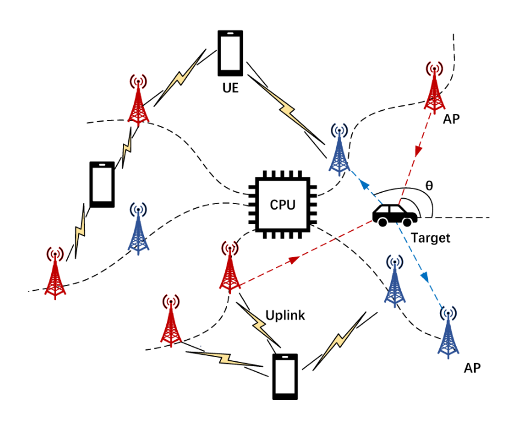
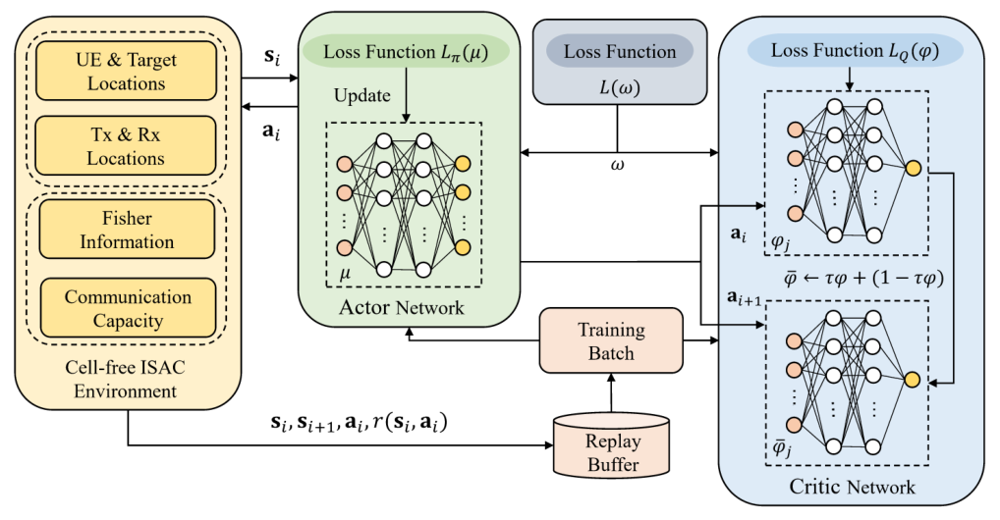
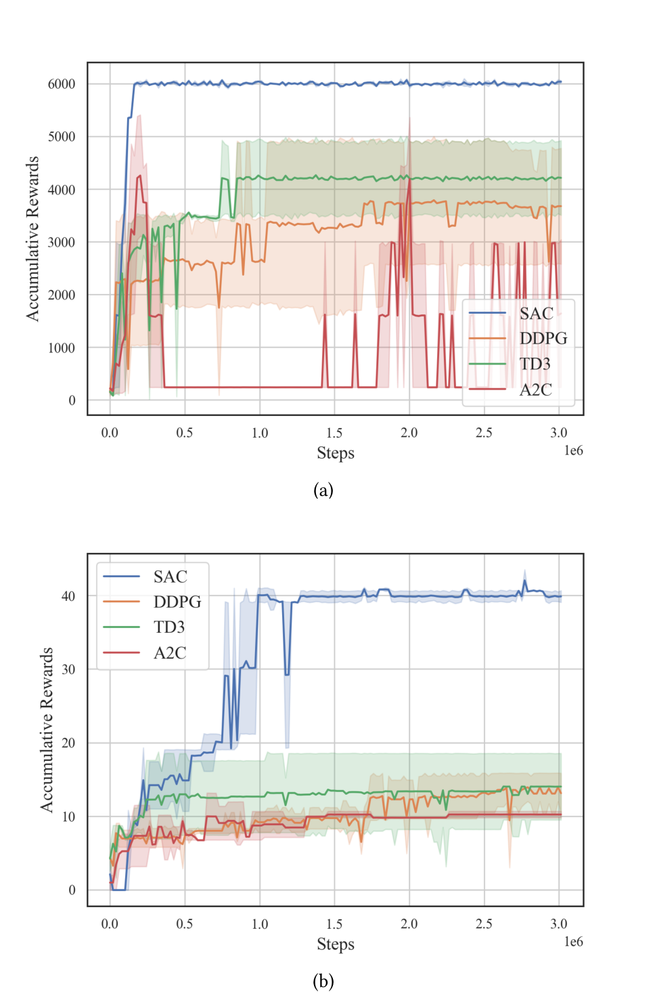
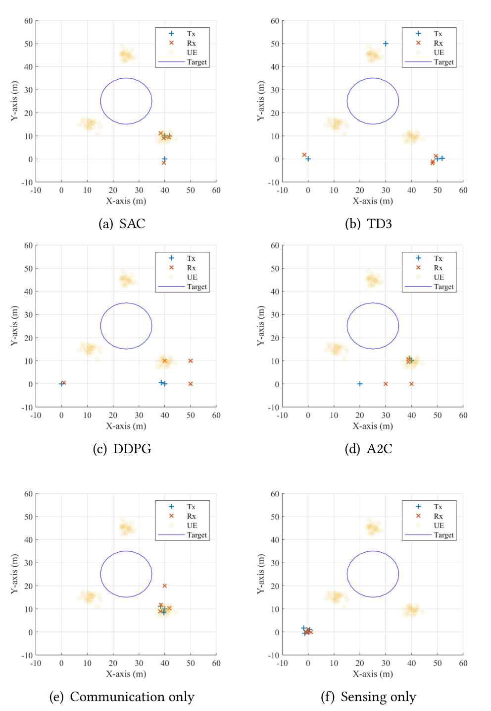
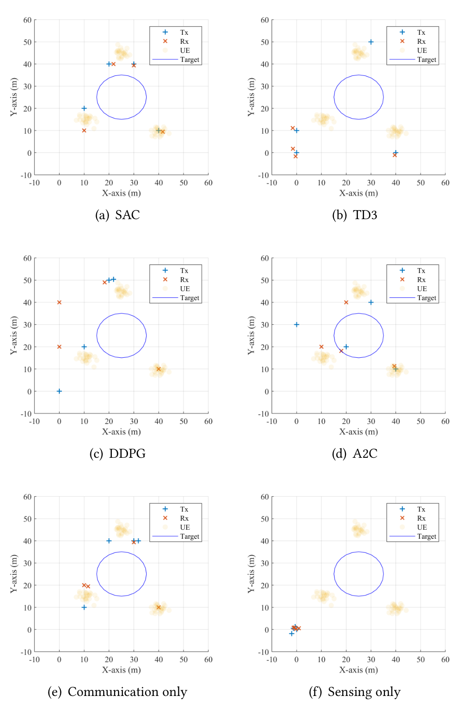

# Access Point Deployment for Localizing Accuracy and User Rate in Cell-Free Systems

Official implementation of the ACM MobiCom '24 paper on soft-actor-critic access-point
deployment for cell-free integrated sensing and communication (ISAC), together with the
archived experiment artifacts of the original study.

[](https://doi.org/10.1145/3636534.3698221)
[](pyproject.toml)
[](LICENSE)
[](https://github.com/OdurShi/cell-free-isac-ap-deployment/actions/workflows/ci.yml)
[](https://github.com/astral-sh/ruff)

## Overview

A cell-free network has `M` transmit and `N` receive access points (APs) that jointly serve
`K` users and localise a moving target. Where the APs stand decides both how well the target
can be localised (the determinant of the Fisher information matrix of the non-coherent
sensing geometry) and how much rate the users get (a Euclidean-distance SNR). The paper
merges the two into one objective, either the product of sum rate and trajectory-averaged
sensing value (max-sum) or the product of the worst user's rate and the worst sensing value
along the trajectory (max-min), and learns the AP coordinates with soft actor-critic (SAC).

<p align="center">
  
  &nbsp;&nbsp;
  
</p>
<p align="center"><em>Figures 1 and 2 of the paper: the cell-free ISAC system and the SAC-based deployment architecture.</em></p>

This repository contains

* `cfisac`, a Python package with the system model, a Gymnasium environment, SAC and the
  baselines DDPG, TD3, A2C and PPO, non-learning optimisers of the same objective, and the
  scripts for the paper's figures and tables;
* `data/`, the scenario and training data produced by the environment with fixed seeds;
* `experiments/`, the saved artifacts of the original study (hyper-parameters, training
  histories, best deployments, plots, checkpoints).

`cfisac` was written from the paper; how each equation, table and unstated constant maps to
code is recorded in [docs/implementation_notes.md](docs/implementation_notes.md).

## Installation

Python 3.10 or newer. With [uv](https://docs.astral.sh/uv/):

```bash
uv venv --python 3.11 .venv
uv pip install -p .venv/bin/python -e ".[dev]"
source .venv/bin/activate
```

With pip:

```bash
python -m venv .venv && source .venv/bin/activate
pip install -e ".[dev]"
# CPU-only PyTorch on Linux: pip install torch --index-url https://download.pytorch.org/whl/cpu
```

Dependencies: NumPy, SciPy, PyTorch, Gymnasium, Matplotlib, PyYAML (`[dev]` adds pytest and
ruff). No GPU and no download are needed.

## Quick start

```bash
cfisac demo          # about one minute on a laptop CPU, writes results/demo/
```

Output (the SAC line depends on the platform's floating-point details):

```text
Scenario: 2T2R, max-sum problem (configs/archived/maxsum_2t2r.yaml)
1) Objective of an example deployment, Eq. (17):
   tx=[[10.0, 10.0], [40.0, 10.0]]  rx=[[30.0, 40.0], [40.0, 10.0]]
   sum rate=0.3892  sensing=15.465  U=6.019
2) Exhaustive search over the 10 m candidate grid:
   optimum U=23.776  tx=[[40.0, 10.0], [40.0, 10.0]]  rx=[[40.0, 10.0], [40.0, 10.0]]
3) SAC, 15360 steps, learning rate 0.0003:
   reward per step=17.850 (75% of the grid optimum)  tx=[[40.0, 10.0], [50.0, 10.0]]  rx=[[40.0, 10.0], [50.0, 10.0]]
4) Learning curve, deployment map and logs written to results/demo/
```

The same building blocks from Python:

```python
from cfisac import APDeploymentEnv, ScenarioConfig, fim_determinant

# Eq. (8): Tx west and east of the target, Rx south and north -> |Phi| = 16
print(fim_determinant([[-5, 0], [5, 0]], [[0, -5], [0, 5]], [[0, 0]]))

env = APDeploymentEnv(ScenarioConfig(n_tx=2, n_rx=2, aggregation="max-sum"))
obs, _ = env.reset(seed=0)                       # 3 UEs + target, Eq. (18)
obs, reward, terminated, truncated, info = env.step(env.action_space.sample())
print(reward, info["comm_sum"], info["sens_mean"], info["tx"], info["rx"])
```

Train an agent, optimise without learning, evaluate or draw a deployment:

```bash
cfisac -v train --scenario configs/archived/maxsum_2t2r.yaml --agent configs/agents/sac_fast.yaml \
    --seed 1 --total-steps 20480 --eval-interval 5120
cfisac optimize --scenario configs/archived/maxmin_2t2r.yaml
cfisac evaluate --scenario configs/archived/maxsum_2t2r.yaml --tx "40,10;40,10" --rx "40,10;40,0"
cfisac deployment --scenario configs/archived/maxsum_2t2r.yaml --tx "40,10;40,10" --rx "40,10;40,0"
```

## Data

The paper uses no external dataset: the training data are generated by the environment.
Both the generated data and the archived artifacts of the original experiments ship with
the repository.

**`data/` - scenario and training data.** Positions of the three UEs (Gaussian around their
centres with variance 2) for a training split (409,600 snapshots, seed 1) and an evaluation
split (32,768 snapshots, seed 0), the 25 sample points of the circular target trajectory,
the 36 candidate AP sites and the UE centres. The training environment, the evaluation and
the optimisers read these files by default (`--data-dir` or `CFISAC_DATA_DIR` select another
location; `cfisac train --online-ues` draws positions on the fly). File layout, seeds,
SHA-256 and the generator are documented in [data/README.md](data/README.md);
`python scripts/generate_data.py` regenerates the files.

**`experiments/` - archived artifacts of the original study.** Saved experiment parameters,
model checkpoints, training records and deployment visualizations:

```text
experiments/<algorithm>/<antenna-setting>/seed-<seed>/
```

Twenty distinct runs cover A2C, DDPG, PPO, SAC, and TD3, with the `1t1r` and `2t2r` antenna
settings and available seeds 1, 128, and 256. The original run names encode a target-circle,
max-mean setting, a 50 m region, a 10.0 m parameter, one target, and three users. The 10.0 m
parameter is retained without assigning a meaning not established by the supplied files.

| File | Contents |
| --- | --- |
| `hyperparameter.json` | Learning rate, batch size, network dimensions, discount factor, and related settings |
| `act*.pth`, `actor.pt`, `cri*.pth` | Actor/critic, target-network, and optimizer checkpoints |
| `recorder.npy`, `recorder_my.csv` | Recorded training history |
| `best_location_origin.npy`, `recorder_best_location.csv` | Deployment-location artifacts |
| `Deployment.png`, `LearningCurve.jpg` | Deployment and learning-curve visualizations |

The supplied archive contained 32 run directories. Twelve were byte-identical copies; this
collection retains all 20 distinct runs. [source-directory-map.csv](source-directory-map.csv)
records the mapping and [experiments.csv](experiments.csv) lists the runs. File names and
parameter values inside each run are unchanged.

These are saved experiment artifacts, not the training implementation: the supplied archive
included no training scripts, environment definitions, model class definitions, or
dependency file. `cfisac` is the implementation written from the paper; its checkpoints use
a different format from the archived ones. The CSV and JSON files can be inspected directly.
NumPy numeric arrays can be inspected with `numpy.load(path, allow_pickle=False)`.
Checkpoints should only be loaded in a trusted environment with the corresponding model
definitions.

## Reproducing the paper

Fig. 3 of the paper shows 3e6 environment steps per run, which is the default of
`cfisac train` (`--total-steps`); the hyper-parameters of Table 1 are in
`configs/agents/sac.yaml`. All commands run on a CPU.

| Paper item | Command | Config |
|---|---|---|
| Table 1, hyper-parameters | - | `configs/agents/sac.yaml` |
| Fig. 3(a), max-sum learning curves | `cfisac train --scenario configs/archived/maxsum_2t2r.yaml --agent configs/agents/<algo>.yaml --seed <seed> --out results/runs/fig3a` for `<algo>` in `sac ddpg td3 a2c` and `<seed>` in `1 128 256`, then `cfisac curves --runs results/runs/fig3a --setting 2t2r --out results/figures/fig3a.png` | `configs/archived/maxsum_2t2r.yaml`, `configs/agents/` |
| Fig. 3(a), from the archived logs | `python scripts/plot_learning_curves.py` | `experiments/` |
| Fig. 3(b), max-min learning curves | as Fig. 3(a) with `--out results/runs/fig3b` | `configs/archived/maxmin_2t2r.yaml`, `configs/agents/` |
| Fig. 4, max-sum deployments (a)-(d) | `cfisac train --scenario configs/archived/maxsum_4t4r.yaml --agent configs/agents/<algo>.yaml --out results/runs/fig4`, then `cfisac deployment --scenario configs/archived/maxsum_4t4r.yaml --run results/runs/fig4/<algo>/4t4r/seed-1` | `configs/archived/maxsum_4t4r.yaml` |
| Fig. 4(e), (f), single objectives | as above with `--objective communication --out results/runs/fig4e` or `--objective sensing --out results/runs/fig4f` | `configs/archived/maxsum_4t4r.yaml` |
| Fig. 5, max-min deployments | as Fig. 4 | `configs/archived/maxmin_4t4r.yaml` |
| Table 2, ISAC value versus number of APs | `cfisac train` with `configs/archived/max{sum,min}_<n>t<n>r.yaml`, then `cfisac evaluate --scenario <same> --run <run dir>` | `configs/archived/max{sum,min}_{1,2,3,4}t{1,2,3,4}r.yaml` |
| Table 3, ISAC / sensing only / comm. only / weighted sum | `cfisac train --objective {isac,sensing,communication,weighted}`, then `cfisac evaluate --run <run dir>` | `configs/archived/max{sum,min}_4t4r.yaml` |
| Tables 2-3 with the non-learning optimisers | `python scripts/make_tables.py`, `python scripts/plot_deployments.py` | `configs/archived/`, `configs/eq8/` |
| Table 3 quantities of the deployments drawn in Figs. 4-5 | `cfisac check-table3` | `configs/archived/max{sum,min}_4t4r.yaml` |

Scenario files come in two families with identical geometry. `configs/archived/` is the
setting of the archived experiments; `configs/eq8/` evaluates the sensing term exactly as
printed in Eq. (8). Section 3 of the
[implementation notes](docs/implementation_notes.md) describes the difference, and every
scenario constant that the paper does not state is a field of these YAML files.

## Method-to-code map

| Paper | Code |
|---|---|
| Eqs. (5)-(8): FIM and its determinant | `src/cfisac/metrics.py`: `fim_terms`, `fim_determinant`, `fim_determinant_from_angles` |
| Eqs. (11), (14): Euclidean-distance SNR | `metrics.py`: `snr` |
| Eq. (15): user rate | `metrics.py`: `user_rates` |
| Eq. (16): deployment region | `src/cfisac/scenario.py`: `ScenarioConfig.snap`, `action_to_positions` |
| Eq. (17): max-sum / max-min objective; Table 3 objectives | `metrics.py`: `evaluate_deployment`, `ObjectiveBreakdown` |
| Eqs. (18)-(20): state, action, reward | `src/cfisac/env.py`: `APDeploymentEnv` |
| Eqs. (21)-(24): SAC | `src/cfisac/agents/sac.py`: `SACAgent._actor_loss`, `_critic_loss`, `_temperature_loss`; `agents/networks.py`: `soft_update` |
| Table 1 | `src/cfisac/agents/base.py`: `AgentConfig`; `configs/agents/` |
| Baselines of Fig. 3 | `agents/td3.py` (`TD3Agent`, `DDPGAgent`), `agents/ppo.py` (`PPOAgent`, `A2CAgent`) |
| Scenario of Section 4, generated data | `scenario.py`, `src/cfisac/data.py`, `scripts/generate_data.py` |
| Training protocol, recorder | `src/cfisac/training.py`: `train`, `evaluate_policy`, `Recorder` |
| Fig. 3 | `src/cfisac/analysis.py`, `plotting.py`: `plot_learning_curves` |
| Figs. 4-5 | `plotting.py`: `plot_deployment` |
| Tables 2-3 | `src/cfisac/tables.py`, `optimize.py`, `cli.py` |

All five agents are compact implementations behind one interface (`agents/base.py: Agent`).
The complete map, the unspecified details and the choices made for them are in
[docs/implementation_notes.md](docs/implementation_notes.md).

## Results

Results from the paper (Fig. 3): accumulated ISAC reward of SAC, DDPG, TD3 and A2C on the
(a) max-sum and (b) max-min problem.

<p align="center">
  
</p>

Results from the paper (Table 2): ISAC value for different numbers of APs.

| Number of APs (M+N) | 2 | 4 | 6 | 8 |
|---|---|---|---|---|
| max-sum: `sum_k R_k / Q * sum_p abs(Phi) / Q` | 41.07 | 775.73 | 3804.47 | 11614.07 |
| max-min: `min_k R_k * min_p abs(Phi)` | 0.042 | 10.48 | 86.06 | 257.28 |

Results from the paper (Table 3): communication rate and localizing accuracy under
different objectives.

| Objective | ISAC | Sensing only | Comm. only | Weighted sum |
|---|---|---|---|---|
| `sum_k R_k / Q` | 1.13 | 0.014 | 1.26 | 0.015 |
| `sum_p abs(Phi) / Q` | 688.97 | 842.92 | 642.08 | 842.92 |
| `min_k R_k` | 0.042 | 0.0013 | 0.043 | 0.0013 |
| `min_p abs(Phi)` | 0.25 | 696.89 | 188.40 | 696.89 |

Results from the paper (Figs. 4 and 5): AP deployments for the max-sum (left) and max-min
(right) problem.

<p align="center">
  
  &nbsp;&nbsp;
  
</p>

Example outputs of this code (analysis of the archived logs, tables and deployment maps from
the optimisers, logs of reduced-length training runs) are in [`results/`](results); the runs
behind them are listed in Section 8 of the
[implementation notes](docs/implementation_notes.md).

## Repository structure

```text
.
├── src/cfisac/
│   ├── metrics.py           # Eqs. (5)-(8), (14), (15), (17): FIM determinant, SNR, rate, objectives
│   ├── reference.py         # loop-based transcription of the same equations (used by tests)
│   ├── scenario.py          # ScenarioConfig: region, grid, trajectory, UEs, objective settings
│   ├── data.py              # generator and loaders of the files in data/
│   ├── env.py               # Gymnasium environment, Eqs. (18)-(20)
│   ├── agents/              # base.py, networks.py, buffer.py, sac.py, td3.py (TD3, DDPG), ppo.py (PPO, A2C)
│   ├── training.py          # training loop, evaluation, recorder, checkpoints
│   ├── optimize.py          # exhaustive search, local search, differential evolution
│   ├── tables.py            # Tables 2-3 from optimised deployments
│   ├── archive.py           # consistency checks against experiments/
│   ├── analysis.py, plotting.py   # recorders -> curves, deployment maps
│   ├── paper_values.py      # numbers printed in the paper, deployments drawn in Figs. 4-5
│   └── cli.py               # `cfisac` command
├── configs/
│   ├── archived/            # scenarios of the archived experiments: max{sum,min}_{1..4}t{1..4}r.yaml
│   ├── eq8/                 # the same scenarios with Eq. (8) as printed
│   └── agents/              # sac.yaml (Table 1), td3, ddpg, a2c, ppo, sac_fast
├── data/                    # UE positions (train / eval), trajectory samples, sites, manifest
├── experiments/             # archived artifacts of the original study
├── experiments.csv, source-directory-map.csv
├── scripts/                 # generate_data.py, plot_learning_curves.py, make_tables.py,
│                            # plot_deployments.py, analyze_archive.py, run_short_training.sh,
│                            # extract_paper_figures.py
├── assets/paper_figures/    # Figures 1-5 of the paper
├── results/                 # example outputs of this code
├── tests/                   # equations, environment, data, agents, training, optimisers, CLI
├── docs/implementation_notes.md
├── CITATION.cff, LICENSE, pyproject.toml
└── .github/workflows/ci.yml
```

## Citation

```bibtex
@inproceedings{xu2024apdeployment,
  author    = {Xu, Fanfei and Liu, Shengheng and Mao, Zihuan and Shi, Shangqing and Xu, Dazhuan and Wang, Dongming and Huang, Yongming},
  title     = {Access Point Deployment for Localizing Accuracy and User Rate in Cell-Free Systems},
  booktitle = {The 30th Annual International Conference on Mobile Computing and Networking (ACM MobiCom '24)},
  year      = {2024},
  publisher = {Association for Computing Machinery},
  address   = {New York, NY, USA},
  doi       = {10.1145/3636534.3698221}
}
```

## License

Code and generated data: [MIT](LICENSE). The images in `assets/paper_figures/` are
reproduced from the published article; see
[assets/paper_figures/README.md](assets/paper_figures/README.md).

## Acknowledgements

* The original experiments used [ElegantRL](https://github.com/AI4Finance-Foundation/ElegantRL)
  (Apache-2.0); this package has no dependency on it.
* The agents follow the published algorithms: SAC (Haarnoja et al., 2018), TD3 (Fujimoto et
  al., 2018), DDPG (Lillicrap et al., 2016), PPO (Schulman et al., 2017), A2C (Mnih et al.,
  2016).
* Built on [Gymnasium](https://github.com/Farama-Foundation/Gymnasium) (MIT),
  [PyTorch](https://github.com/pytorch/pytorch) (BSD-3-Clause), NumPy, SciPy and Matplotlib.
* A ray-tracing-based 3-D extension of the deployment idea is in
  [OdurShi/sionna-isac-simulation](https://github.com/OdurShi/sionna-isac-simulation).
